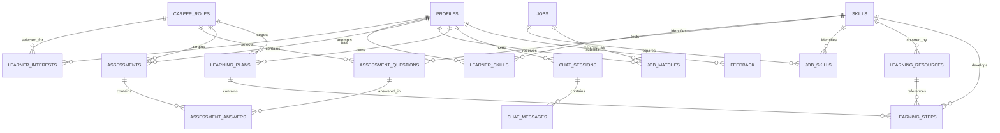

# Career Compass — Database ER Diagram

**Database:** PostgreSQL (Supabase)  
**ORM:** SQLAlchemy 2.0  
**Migrations:** Alembic

## 1. Confirmed database design decisions

| Area | Decision |
|---|---|
| Authentication | Supabase Auth |
| Education and experience | JSONB fields in `profiles` |
| Career interests | Multiple interests per learner |
| Skills | Centralized skill catalogue |
| Assessments | Multiple attempts per learner |
| Job listings | Provider-independent normalized records |
| Job matches | Persist results in PostgreSQL |
| Chat history | Save sessions and messages |
| Resume storage | Do not retain original resume or raw extracted text |
| Database migrations | Alembic |

## 2. Database entities

### User and career profile

| Table | Purpose |
|---|---|
| `profiles` | Learner profile, education, experience and account role |
| `career_roles` | Catalogue of supported career paths |
| `learner_interests` | Career roles selected by each learner |
| `skills` | Central catalogue of canonical skills |
| `learner_skills` | Skills associated with a learner, including proficiency and evidence |

### Assessment

| Table | Purpose |
|---|---|
| `assessment_questions` | Role-specific questions mapped to skills |
| `assessments` | Individual assessment attempts |
| `assessment_answers` | Answers submitted during assessments |

### Jobs and matching

| Table | Purpose |
|---|---|
| `jobs` | Normalized job listings from external or curated sources |
| `job_skills` | Skills required or preferred for each job |
| `job_matches` | Persisted matching results between learners and jobs |
| `job_ingestion_logs` | Records of scheduled job ingestion runs |

### Learning

| Table | Purpose |
|---|---|
| `learning_resources` | Verified learning resources and associated skills |
| `learning_plans` | Personalized learning plans |
| `learning_steps` | Ordered steps within learning plans |

### Career assistant and feedback

| Table | Purpose |
|---|---|
| `chat_sessions` | Individual career-assistant conversations |
| `chat_messages` | Persistent messages belonging to conversations |
| `feedback` | User feedback on recommendations and platform features |

## 3. Entity Relationship Diagram

## 4. Proposed table structures

### `profiles`

- `id` — UUID, primary key, references `auth.users.id`
- `full_name` — VARCHAR
- `phone` — VARCHAR, nullable
- `location` — VARCHAR, nullable
- `education` — JSONB, nullable
- `experience` — JSONB, nullable
- `account_role` — VARCHAR, default `learner`
- `created_at` — TIMESTAMPTZ
- `updated_at` — TIMESTAMPTZ

Education and experience remain flexible JSONB structures. This avoids introducing separate tables for the initial MVP.

### `career_roles`

- `id` — UUID, primary key
- `name` — VARCHAR, unique
- `description` — TEXT
- `is_active` — BOOLEAN
- `created_at` — TIMESTAMPTZ

### `learner_interests`

- `id` — UUID, primary key
- `learner_id` — UUID, FK to profiles
- `career_role_id` — UUID, FK to career_roles
- `is_primary` — BOOLEAN
- `created_at` — TIMESTAMPTZ

Unique constraint: `(learner_id, career_role_id)`.

### `skills`

- `id` — UUID, primary key
- `name` — VARCHAR, unique
- `description` — TEXT, nullable
- `category` — VARCHAR, nullable
- `created_at` — TIMESTAMPTZ

### `learner_skills`

- `id` — UUID, primary key
- `learner_id` — UUID, FK to profiles
- `skill_id` — UUID, FK to skills
- `proficiency_level` — VARCHAR, nullable
- `evidence_source` — VARCHAR
- `confidence_score` — NUMERIC, nullable
- `updated_at` — TIMESTAMPTZ

Unique constraint: `(learner_id, skill_id)`.

### `assessment_questions`

- `id` — UUID, primary key
- `career_role_id` — UUID, FK to career_roles
- `skill_id` — UUID, FK to skills
- `question_text` — TEXT
- `options` — JSONB
- `correct_answer` — VARCHAR
- `explanation` — TEXT, nullable
- `difficulty` — VARCHAR
- `is_active` — BOOLEAN

Correct answers must never be exposed through learner-facing question APIs before submission.

### `assessments`

- `id` — UUID, primary key
- `learner_id` — UUID, FK to profiles
- `career_role_id` — UUID, FK to career_roles
- `total_questions` — INTEGER
- `correct_answers` — INTEGER
- `score` — NUMERIC
- `status` — VARCHAR
- `started_at` — TIMESTAMPTZ
- `completed_at` — TIMESTAMPTZ, nullable

### `assessment_answers`

- `id` — UUID, primary key
- `assessment_id` — UUID, FK to assessments
- `question_id` — UUID, FK to assessment_questions
- `selected_answer` — VARCHAR
- `is_correct` — BOOLEAN
- `answered_at` — TIMESTAMPTZ

Unique constraint: `(assessment_id, question_id)`.

### `jobs`

- `id` — UUID, primary key
- `source` — VARCHAR
- `external_id` — VARCHAR
- `title` — VARCHAR
- `company` — VARCHAR
- `description` — TEXT
- `location` — VARCHAR
- `employment_type` — VARCHAR, nullable
- `experience_min` — NUMERIC, nullable
- `experience_max` — NUMERIC, nullable
- `salary_min` — NUMERIC, nullable
- `salary_max` — NUMERIC, nullable
- `currency` — VARCHAR, default `INR`
- `application_url` — TEXT
- `posted_at` — TIMESTAMPTZ, nullable
- `last_verified_at` — TIMESTAMPTZ
- `is_active` — BOOLEAN
- `created_at` — TIMESTAMPTZ
- `updated_at` — TIMESTAMPTZ

Unique constraint: `(source, external_id)`.

### `job_skills`

- `id` — UUID, primary key
- `job_id` — UUID, FK to jobs
- `skill_id` — UUID, FK to skills
- `requirement_type` — VARCHAR (`required` or `preferred`)
- `importance` — NUMERIC, nullable

Unique constraint: `(job_id, skill_id)`.

### `job_matches`

- `id` — UUID, primary key
- `learner_id` — UUID, FK to profiles
- `job_id` — UUID, FK to jobs
- `match_score` — NUMERIC
- `matched_skills` — JSONB
- `missing_skills` — JSONB
- `explanation` — TEXT, nullable
- `generated_at` — TIMESTAMPTZ

Unique constraint: `(learner_id, job_id)`.

Matches are stored so learners can retrieve recommendations without recalculating every result. They can be refreshed when relevant learner skills or job information changes. The timestamp indicates when a result was last generated.

A match score represents compatibility, not the probability of being hired.

### `job_ingestion_logs`

- `id` — UUID, primary key
- `source` — VARCHAR
- `started_at` — TIMESTAMPTZ
- `completed_at` — TIMESTAMPTZ, nullable
- `status` — VARCHAR
- `fetched_count` — INTEGER
- `inserted_count` — INTEGER
- `updated_count` — INTEGER
- `rejected_count` — INTEGER
- `error_message` — TEXT, nullable

### `learning_resources`

- `id` — UUID, primary key
- `skill_id` — UUID, FK to skills
- `title` — VARCHAR
- `description` — TEXT, nullable
- `provider` — VARCHAR
- `resource_url` — TEXT
- `resource_type` — VARCHAR
- `is_free` — BOOLEAN
- `is_verified` — BOOLEAN
- `created_at` — TIMESTAMPTZ

### `learning_plans`

- `id` — UUID, primary key
- `learner_id` — UUID, FK to profiles
- `career_role_id` — UUID, FK to career_roles
- `title` — VARCHAR
- `description` — TEXT, nullable
- `status` — VARCHAR
- `created_at` — TIMESTAMPTZ
- `updated_at` — TIMESTAMPTZ

### `learning_steps`

- `id` — UUID, primary key
- `learning_plan_id` — UUID, FK to learning_plans
- `skill_id` — UUID, FK to skills
- `resource_id` — UUID, FK to learning_resources, nullable
- `title` — VARCHAR
- `description` — TEXT, nullable
- `sequence_number` — INTEGER
- `status` — VARCHAR
- `completed_at` — TIMESTAMPTZ, nullable

Unique constraint: `(learning_plan_id, sequence_number)`.

### `chat_sessions`

- `id` — UUID, primary key
- `learner_id` — UUID, FK to profiles
- `title` — VARCHAR, nullable
- `created_at` — TIMESTAMPTZ
- `updated_at` — TIMESTAMPTZ

### `chat_messages`

- `id` — UUID, primary key
- `session_id` — UUID, FK to chat_sessions
- `sender` — VARCHAR (`user` or `assistant`)
- `content` — TEXT
- `provider` — VARCHAR, nullable
- `created_at` — TIMESTAMPTZ

Chat sessions and messages are retained so learners can revisit earlier conversations. They must be included in the account data deletion workflow.

### `feedback`

- `id` — UUID, primary key
- `learner_id` — UUID, FK to profiles
- `category` — VARCHAR
- `rating` — INTEGER, nullable
- `message` — TEXT, nullable
- `created_at` — TIMESTAMPTZ

## 5. Database implementation rules

1. Use UUID primary keys for application tables.
2. Use PostgreSQL `TIMESTAMPTZ` and store timestamps in UTC.
3. Use foreign keys and appropriate delete behavior.
4. Add indexes to frequently queried foreign keys and search fields.
5. Add unique constraints to prevent duplicate interests, learner skills, job listings and assessment answers.
6. Use SQLAlchemy 2.0 declarative models.
7. Use Alembic for every database schema change.
8. Use Supabase Auth for authentication and link profiles to `auth.users`.
9. Protect learner-owned records using authorization checks and appropriate Supabase RLS policies.
10. Never expose assessment answer keys through learner-facing API responses.
11. Do not store uploaded resumes or raw extracted resume text.
12. Keep job-source-specific logic out of the matching engine.
13. Store generated job matches and refresh them when appropriate.
14. Retain chat messages while providing users with a way to delete their conversation history.

## 6. Implementation notes

- `account_role` must be controlled by trusted backend/admin processes. Users must not be able to promote themselves to administrators.
- Assessment questions should be curated and scoring should be reproducible.
- Preserve historical assessment attempts.
- Job matches should have a clear refresh strategy to avoid serving outdated recommendations.
- Chat history should follow appropriate retention and deletion controls.
- Use JSONB for flexible profile information, not as a substitute for relational tables.
- Persist structured resume information only after the learner reviews and confirms it.
- Add database indexes and RLS policies as part of implementation.

---

**Status:** Proposed database design — decisions confirmed, ready for SQLAlchemy model implementation after API contract review.